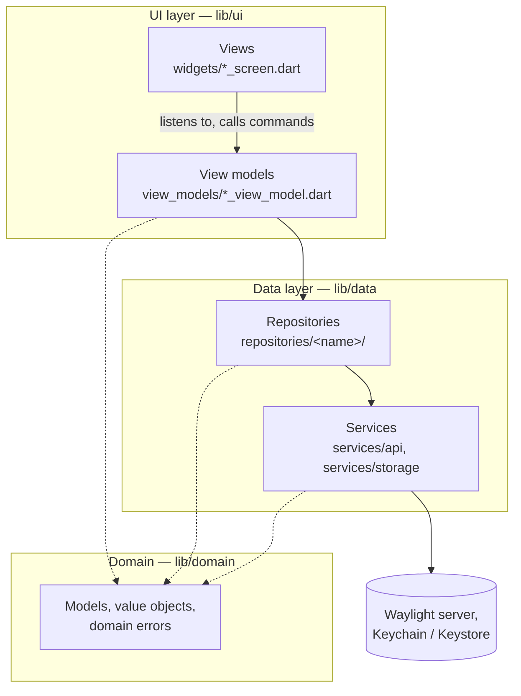
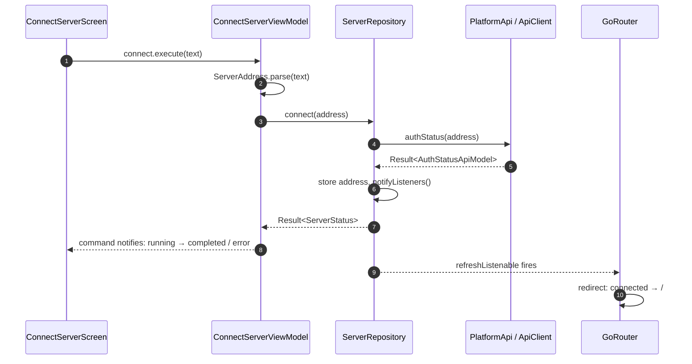

# Architecture

The app follows the [architecture guide of the Flutter team](https://docs.flutter.dev/app-architecture):
MVVM in the UI, repositories as the single source of truth, stateless
services at the edge. This is the Flutter counterpart of the Clean
Architecture of the server ([ADR 0001](adr/0001-app-architecture.md)): the
same idea, dependencies point inwards, in the vocabulary Flutter developers
know.

## The layers



| Layer | Folder | Responsibility | May import |
| --- | --- | --- | --- |
| Utilities | `lib/utils` | `Result`, `Command` | `flutter/foundation` |
| Domain | `lib/domain/models` | Immutable models and value objects with their rules (e.g. `ServerAddress.parse`), domain errors. Pure Dart. | utils |
| Services | `lib/data/services` | Wrap one external thing each: the HTTP API, the secure storage. Stateless, return `Result`, map JSON to API models. | utils, domain, `http`, `flutter_secure_storage`, `logging` |
| Repositories | `lib/data/repositories/<name>` | Single source of truth for one kind of data. Combine services, cache, map API models to domain models, notify listeners. Abstract class + implementation. | utils, domain, services |
| View models | `lib/ui/<feature>/view_models` | State and actions of one screen as `ChangeNotifier` with `Command`s. No widgets, no `BuildContext`. | utils, domain, repositories (abstract) |
| Views | `lib/ui/<feature>/widgets` | Widgets. Render the view model, forward user input to commands. No logic beyond layout. | view model of the same feature, `ui/core`, l10n |
| Shared UI | `lib/ui/core` | The design system: theme tokens, reusable components, shared error texts, localisation helpers ([UI components](ui-components.md)). | utils, domain, l10n |
| Routing | `lib/routing` | `GoRouter`, route constants, redirects. Creates view models per route. | repositories, ui |
| Composition root | `lib/config`, `lib/main.dart`, `lib/app.dart` | Creates the concrete services and repositories and provides them. The only place that knows implementations. | everything |

### Rules

1. **Dependencies point inwards.** The domain knows nothing about Flutter,
   HTTP or storage. Services know nothing about repositories, repositories
   nothing about the UI.
2. **Views talk to view models only.** A view never calls a repository or a
   service, and never holds state that matters beyond the widget (text
   controllers and animations are fine).
3. **View models talk to repositories only,** through their abstract class.
   Services are an implementation detail of the data layer.
4. **Features never import each other.** Two screens that need the same data
   share a repository, two screens that need the same widget move it to
   `ui/core`.
5. **Expected failures are values.** Services and repositories return
   `Result<T>`; `switch` over it is exhaustive. Only programming errors throw.
6. **One way to do each thing:** `provider` for dependency injection,
   `ChangeNotifier` + `Command` for state, `ViewModelHost` for the life of
   a view model, `go_router` for navigation, the components of `ui/core`
   for UI, `gen-l10n` for texts, `logging` for logs
   ([ADR 0002](adr/0002-flutter-stack.md), [ADR 0005](adr/0005-design-system.md)).

### Enforcement

| Check | What it enforces |
| --- | --- |
| `test/architecture_test.dart` | The import matrix above, no imports between features, no `package:flutter/material.dart` (use `material_ui`), package imports only |
| `test/conventions_test.dart` | No colour literals or font sizes outside the theme, no `print`, TODOs with issue, route constants |
| `flutter analyze --fatal-infos` | Strict casts, inference and raw types, docs on every public member, the lint set in `analysis_options.yaml` |
| `dart format --set-exit-if-changed` | One formatting |
| `tool/check_coverage.dart` | At least 80 % line coverage of `lib/` |

All of them run in `make ci` and in CI on every pull request.

## Folder structure

```
lib/
├── main.dart                 start: logging, restore state, runApp
├── app.dart                  MaterialApp.router: theme, languages
├── config/                   composition root (dependencies.dart), logging
├── routing/                  router.dart (GoRouter, redirects), routes.dart
├── utils/                    result.dart, command.dart
├── domain/models/            server_address.dart, server_status.dart, api_exception.dart
├── data/
│   ├── services/
│   │   ├── api/              api_client.dart, platform_api.dart, models/ (JSON ↔ Dart)
│   │   └── storage/          key_value_store.dart
│   └── repositories/
│       └── server/           server_repository.dart (abstract), server_repository_remote.dart
├── ui/
│   ├── core/                 themes/ (AppTheme, StatusColors, Dimens), widgets/ (CommandButton,
│   │                         MessageBanner, SectionCard, FormPage, Wordmark, ViewModelHost),
│   │                         error_messages.dart, localization.dart
│   ├── connect_server/       view_models/, widgets/
│   └── home/                 view_models/, widgets/
└── l10n/                     app_en.arb, app_de.arb, generated/ (committed)

test/                         mirrors lib/; testing/ holds fakes and helpers
```

## How a screen works

The connect screen is the reference implementation; copy its structure for
new screens ([adding a feature](adding-a-feature.md)).



- **Commands** (`lib/utils/command.dart`) wrap every asynchronous action of a
  view model. They prevent double taps and expose `running`, `completed`,
  `error` and `result`, so views need no flags of their own.
- **Navigation follows state.** After connecting, nobody calls
  `context.go`: the router listens to the `ServerRepository` and redirects.
  The same will hold for sign-in and sign-out. Use `context.go` only for
  navigation the user chose (opening a detail screen).
- **View models live as long as their route.** Each route creates its view
  model in a `ViewModelHost`, which keeps it across router rebuilds and
  disposes it with the screen; the repositories are app-wide singletons from
  `config/dependencies.dart`.
- **Screens are built from the design system.** Buttons that run a command
  are `CommandButton`s, failures are `MessageBanner`s, cards are
  `SectionCard`s; colours, type and spacing come from the theme
  ([UI components](ui-components.md)).

## Design patterns

Each pattern is used because it solves a problem we have, not for its own
sake ([code conventions](code-conventions.md#1-principles)).

| Pattern | Where | Problem it solves |
| --- | --- | --- |
| MVVM | `ui/<feature>/{widgets,view_models}` | Keeps logic out of widgets; view models are testable without Flutter UI |
| Command | `utils/command.dart`, `CommandButton` | One way to run an action and show running / done / failed; prevents double submits |
| Result | `utils/result.dart` | Expected failures are values the compiler makes you handle |
| Repository | `data/repositories` | One source of truth per kind of data; hides where data comes from |
| Adapter (service) | `data/services` | Wraps one external system (HTTP API, secure storage) behind a small interface |
| Observer | `ChangeNotifier`, `ListenableBuilder`, `refreshListenable` | Views and router follow state instead of being told |
| Dependency injection, composition root | `config/dependencies.dart`, `provider` | Only one place knows implementations; tests swap in fakes |
| Value object | `ServerAddress` | Validation once, at the boundary; invalid values cannot exist |
| Theme extension (design tokens) | `ui/core/themes` | Colours and sizes in one place, switched with light and dark |
| Registry (planned, #17) | dashboard widgets | New widget kinds without touching the dashboard ([below](#dashboard-widgets)) |

Not used on purpose: service locators (hide dependencies), global
singletons (untestable), inheritance between view models or screens
(composition instead), event buses (state flows through repositories).

## Dashboard widgets

The dashboard (#16) shows widgets of many kinds, each of them a feature of
its own (#17). To keep "features never import each other", the dashboard
does not know any widget:

1. `ui/core` defines a small registry type: a map from the widget kind of
   the server (`todos`, `weather` …) to a builder that takes the placement
   and returns a widget.
2. Each widget kind is a feature folder named after its server module
   (`ui/todos/`, `ui/weather/` …) and offers its builder, which hosts its
   own view model with `ViewModelHost`.
3. The composition root (`config/`) builds the registry from the enabled
   features and provides it; the dashboard looks kinds up and falls back to
   the fallback card (#18) for unknown kinds.

Adding a widget kind is then a new feature folder plus one line in the
composition root (open/closed principle). The exact API is settled in #17.

### Grid and sizes

On the dashboard, a widget either has a size or takes the full width at
its natural height (#208, [ADR 0012](adr/0012-dashboard-grid.md)). Sized
widgets sit on a grid of square cells, 4 wide on phones and 8 on tablets:

| Size | Cells | Typical use |
| --- | --- | --- |
| `small` | 2 × 2 | clock, weather, next event, next departure |
| `medium` | 4 × 2 | the first to-dos, a few services, bookmarks |
| `large` | 4 × 4 | lists: to-dos, calendar, feeds |
| `strip` | 4 × 1 | one line: status overview, next waste collection |

- `packGrid` (domain) places the widgets in display order and fills gaps
  (dense packing); `SizedGrid` (`ui/core`) turns the cells into pixels for
  the dashboard, its edit mode and the size sheet alike.
- A `WidgetTile` builds the widget's view below a `WidgetSizeScope`, in a
  box of the tile's size; taller content fades out, and a tap opens the
  widget in full (`WidgetFullScreen`). Buttons inside the view keep their
  own taps.
- A view that has a compact form asks `WidgetSizeScope.maybeOf(context)`
  and shows what fits; without a scope (list, full view) it shows
  everything (#211). Small and strip tiles use `CompactCard`: a view built
  on `WidgetFrame` passes `compact:` and gets the card, its title and the
  loading and error states for free; a view without a compact form shows
  *tap to see everything* there instead of overflowing.
- Widgets whose module has a server compact state wrap their view in
  `CompactStateWidget.orFull`. Which modules have one comes from the
  `compact` list of `GET /api/modules`: the dashboard reads it with the
  tabs (`CompactStateRepository.load`), so the synchronous `supports()`
  can answer while tiles are built; offline the stored answer counts, and
  servers without the list keep to-dos, habits and focus (#274). Kinds
  named differently from their module (`backup-status`,
  `status-overview`) are mapped in the repository, and parameters such as
  the smart home `entity` come from the widget's configuration; the DNS
  filter `provider` and the electricity `zone` fall back to the widgets'
  defaults (AdGuard Home, DE-LU) as on the web (#278). Weather takes the
  server's state when the server lists it and derives its own otherwise;
  the weather tile itself keeps its own small view from the full forecast.
- The tree of a tile does not change when its content starts or stops to
  overflow (the fade is always there, only its gradient changes), so the
  view and its view model are never created again — otherwise a view that
  grows while loading would load in a loop and flicker.
- The edit mode (#209) is a mode of the dashboard, not a route: holding a
  widget or the *Arrange tab* button creates an `ArrangeViewModel` in
  `DashboardViewModel.arranging`, and the dashboard shows `ArrangeView` on
  the same grid. Tiles wiggle (not with reduced animations), widgets move
  by dragging or with *move earlier / later* in their sheet, change size,
  hide and show again; *Done* saves the phone layout in one request and
  reloads, back asks before discarding changes.
- *Add widget* in the edit mode opens the gallery (#210): the kinds of
  `GET /api/modules`, searchable. Adding stores the widget on the server
  right away, below the desktop grid (half its width, so it fits on every
  desktop), and it joins the phone layout as a small tile.
- Above the widgets of a tab, the attention strip (#335) lists up to
  three things that need attention now, problems first, and counts the
  rest: widgets whose connection stopped working on the server's
  attention list (`GET /api/attention`) and widgets whose compact state
  has the level `problem` or `attention`. The dashboard reads those states
  with the tabs, the same requests that find empty widgets. Widgets that
  are not set up stay on the attention screen (#229).
- Sizes are part of the phone layout of a tab. The dashboard repository
  sends them to servers that know them (Waylight-App/waylight#585) and
  keeps them on the device for the others.

## Models at the boundaries

| Model | Lives in | Example | Purpose |
| --- | --- | --- | --- |
| API model | `data/services/api/models` | `AuthStatusApiModel` | Exactly the JSON of one endpoint (see `api/modules/*.yaml` of the server). Parsed with patterns; unknown shapes become `null` or an `ApiException`. |
| Domain model | `domain/models` | `ServerStatus` | What the app needs, independent of the JSON. Immutable, with `==` and `hashCode`. |
| UI state | view model getters | `SignInViewModel.server` | Formatted for display. |

Mapping happens in the repository. A new server field never reaches a
widget without passing through the domain model.

## Errors

- Network and HTTP failures become an `ApiException` with an `ApiFailure`
  (`unreachable`, `unauthorized`, `invalid`, …) and, if the server sent one,
  its `code`, `message` and `field` (the server's error envelope).
- Validation failures of the domain are domain exceptions, e.g.
  `InvalidServerAddress` with a reason.
- Views translate errors into texts: their own errors with an exhaustive
  `switch` (`fieldError` in `connect_server_screen.dart`), everything else
  with `l10n.errorMessage(error)` from `ui/core/error_messages.dart`. The
  English server message is never shown as is.

## The server API

The app uses the JSON API of the [Waylight server](https://github.com/Waylight-App/waylight).
Its OpenAPI description is `api/openapi.base.yaml` plus one fragment per
module in `api/modules/`. API models are written by hand from those
fragments, one file per endpoint group, and covered by tests with recorded
JSON. If the app needs something the API does not offer, open an issue in
the server repository and label the app issue `needs: server`.
