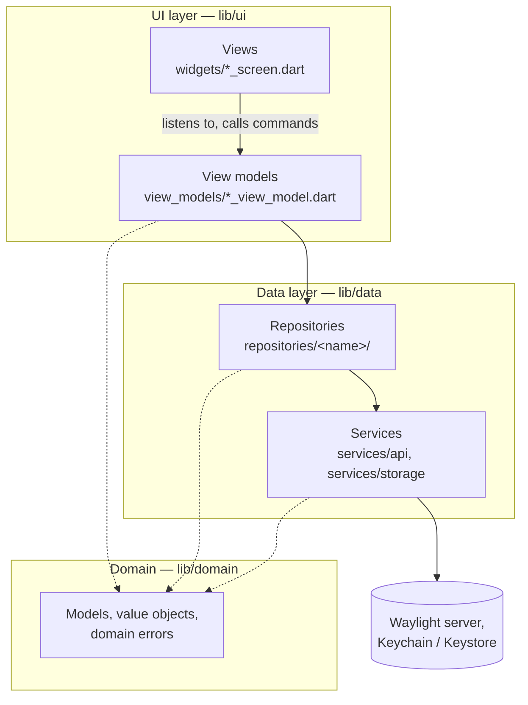
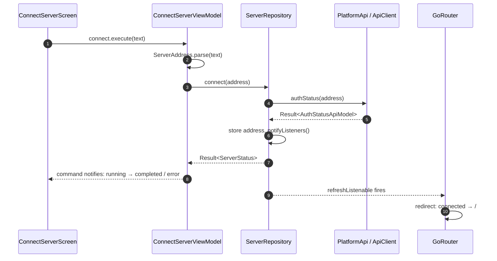

# Architecture

The app follows the [architecture guide of the Flutter team](https://docs.flutter.dev/app-architecture):
MVVM in the UI, repositories as the single source of truth, stateless
services at the edge. This is the Flutter counterpart of the Clean
Architecture of the server ([ADR 0001](adr/0001-app-architecture.md)): the
same idea, dependencies point inwards, in the vocabulary Flutter developers
know.

## The layers



| Layer | Folder | Responsibility | May import |
| --- | --- | --- | --- |
| Utilities | `lib/utils` | `Result`, `Command` | `flutter/foundation` |
| Domain | `lib/domain/models` | Immutable models and value objects with their rules (e.g. `ServerAddress.parse`), domain errors. Pure Dart. | utils |
| Services | `lib/data/services` | Wrap one external thing each: the HTTP API, the secure storage. Stateless, return `Result`, map JSON to API models. | utils, domain, `http`, `flutter_secure_storage`, `logging` |
| Repositories | `lib/data/repositories/<name>` | Single source of truth for one kind of data. Combine services, cache, map API models to domain models, notify listeners. Abstract class + implementation. | utils, domain, services |
| View models | `lib/ui/<feature>/view_models` | State and actions of one screen as `ChangeNotifier` with `Command`s. No widgets, no `BuildContext`. | utils, domain, repositories (abstract) |
| Views | `lib/ui/<feature>/widgets` | Widgets. Render the view model, forward user input to commands. No logic beyond layout. | view model of the same feature, `ui/core`, l10n |
| Shared UI | `lib/ui/core` | Theme, spacing, shared widgets, localisation helpers. | utils, domain, l10n |
| Routing | `lib/routing` | `GoRouter`, route constants, redirects. Creates view models per route. | repositories, ui |
| Composition root | `lib/config`, `lib/main.dart`, `lib/app.dart` | Creates the concrete services and repositories and provides them. The only place that knows implementations. | everything |

### Rules

1. **Dependencies point inwards.** The domain knows nothing about Flutter,
   HTTP or storage. Services know nothing about repositories, repositories
   nothing about the UI.
2. **Views talk to view models only.** A view never calls a repository or a
   service, and never holds state that matters beyond the widget (text
   controllers and animations are fine).
3. **View models talk to repositories only,** through their abstract class.
   Services are an implementation detail of the data layer.
4. **Features never import each other.** Two screens that need the same data
   share a repository, two screens that need the same widget move it to
   `ui/core`.
5. **Expected failures are values.** Services and repositories return
   `Result<T>`; `switch` over it is exhaustive. Only programming errors throw.
6. **One way to do each thing:** `provider` for dependency injection,
   `ChangeNotifier` + `Command` for state, `go_router` for navigation,
   `gen-l10n` for texts, `logging` for logs ([ADR 0002](adr/0002-flutter-stack.md)).

### Enforcement

| Check | What it enforces |
| --- | --- |
| `test/architecture_test.dart` | The import matrix above, no imports between features, no `package:flutter/material.dart` (use `material_ui`), package imports only |
| `flutter analyze --fatal-infos` | Strict casts, inference and raw types, docs on every public member, the lint set in `analysis_options.yaml` |
| `dart format --set-exit-if-changed` | One formatting |
| `tool/check_coverage.dart` | At least 80 % line coverage of `lib/` |

All of them run in `make ci` and in CI on every pull request.

## Folder structure

```
lib/
├── main.dart                 start: logging, restore state, runApp
├── app.dart                  MaterialApp.router: theme, languages
├── config/                   composition root (dependencies.dart), logging
├── routing/                  router.dart (GoRouter, redirects), routes.dart
├── utils/                    result.dart, command.dart
├── domain/models/            server_address.dart, server_status.dart, api_exception.dart
├── data/
│   ├── services/
│   │   ├── api/              api_client.dart, platform_api.dart, models/ (JSON ↔ Dart)
│   │   └── storage/          key_value_store.dart
│   └── repositories/
│       └── server/           server_repository.dart (abstract), server_repository_remote.dart
├── ui/
│   ├── core/                 themes/, widgets/, localization.dart
│   ├── connect_server/       view_models/, widgets/
│   └── home/                 view_models/, widgets/
└── l10n/                     app_en.arb, app_de.arb, generated/ (committed)

test/                         mirrors lib/; testing/ holds fakes and helpers
```

## How a screen works

The connect screen is the reference implementation; copy its structure for
new screens ([adding a feature](adding-a-feature.md)).



- **Commands** (`lib/utils/command.dart`) wrap every asynchronous action of a
  view model. They prevent double taps and expose `running`, `completed`,
  `error` and `result`, so views need no flags of their own.
- **Navigation follows state.** After connecting, nobody calls
  `context.go`: the router listens to the `ServerRepository` and redirects.
  The same will hold for sign-in and sign-out. Use `context.go` only for
  navigation the user chose (opening a detail screen).
- **View models live as long as their route.** The router creates them; the
  repositories are app-wide singletons from `config/dependencies.dart`.

## Models at the boundaries

| Model | Lives in | Example | Purpose |
| --- | --- | --- | --- |
| API model | `data/services/api/models` | `AuthStatusApiModel` | Exactly the JSON of one endpoint (see `api/modules/*.yaml` of the server). Parsed with patterns; unknown shapes become `null` or an `ApiException`. |
| Domain model | `domain/models` | `ServerStatus` | What the app needs, independent of the JSON. Immutable, with `==` and `hashCode`. |
| UI state | view model getters | `HomeViewModel.server` | Formatted for display. |

Mapping happens in the repository. A new server field never reaches a
widget without passing through the domain model.

## Errors

- Network and HTTP failures become an `ApiException` with an `ApiFailure`
  (`unreachable`, `unauthorized`, `invalid`, …) and, if the server sent one,
  its `code`, `message` and `field` (the server's error envelope).
- Validation failures of the domain are domain exceptions, e.g.
  `InvalidServerAddress` with a reason.
- Views translate errors into texts with an exhaustive `switch`
  (`errorText` in `connect_server_screen.dart`); the English server message
  is never shown as is.

## The server API

The app uses the JSON API of the [Waylight server](https://github.com/Waylight-App/waylight).
Its OpenAPI description is `api/openapi.base.yaml` plus one fragment per
module in `api/modules/`. API models are written by hand from those
fragments, one file per endpoint group, and covered by tests with recorded
JSON. If the app needs something the API does not offer, open an issue in
the server repository and label the app issue `needs: server`.
