# Design

Mockups of the planned screens. They show what the app will look like and
which reusable components it needs ([UI components](../ui-components.md));
they are not app code. Each screen belongs to an issue of the
[roadmap](../../ROADMAP.md).

- `screens/` — PNG of every mockup, for issues and reviews
- `mockups/` — the same mockups as static HTML; open `mockups/connect.html`
  in a browser and click through: Connect → Sign in → Code → Dashboard,
  and from there search, settings and *Capture*

The mockups were drawn on a design canvas; the HTML here is exported from
it. When a design changes, update the HTML and the PNG in the same pull
request as the code.

## Screens

| | | |
| --- | --- | --- |
| 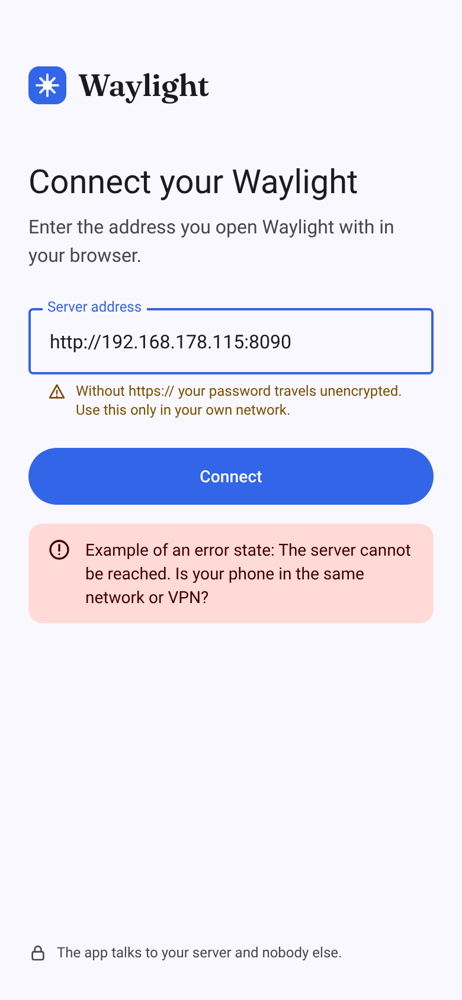 | 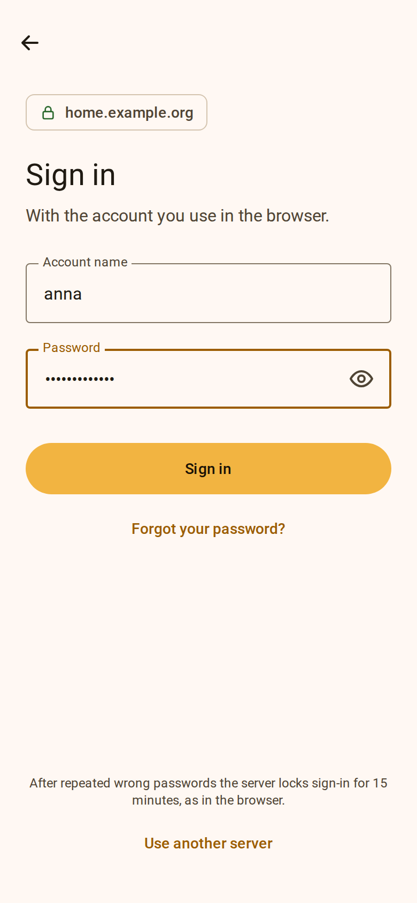 | 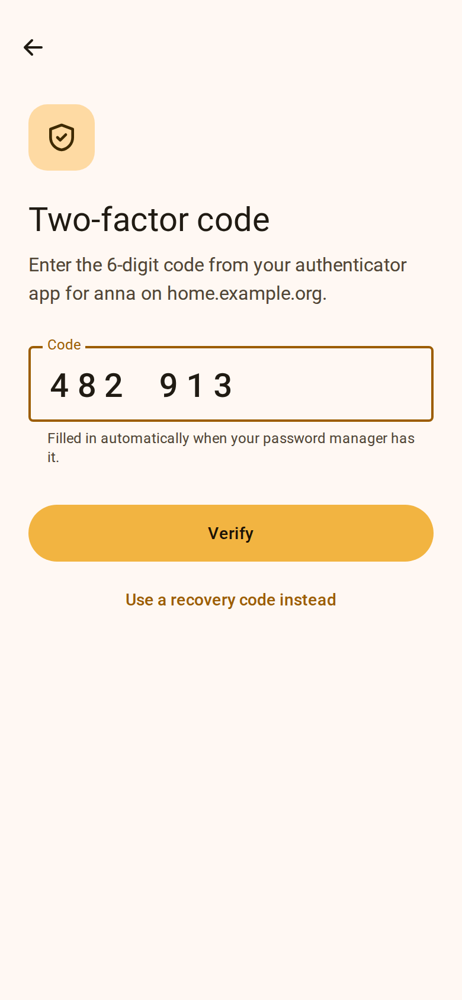 |
| **Connect** — HTTP warning under the field, error banner ([#7](https://github.com/Waylight-App/waylight-mobile/issues/7)) | **Sign in** with password manager support ([#12](https://github.com/Waylight-App/waylight-mobile/issues/12)) | **Two-factor code**, recovery code as alternative ([#12](https://github.com/Waylight-App/waylight-mobile/issues/12)) |
| 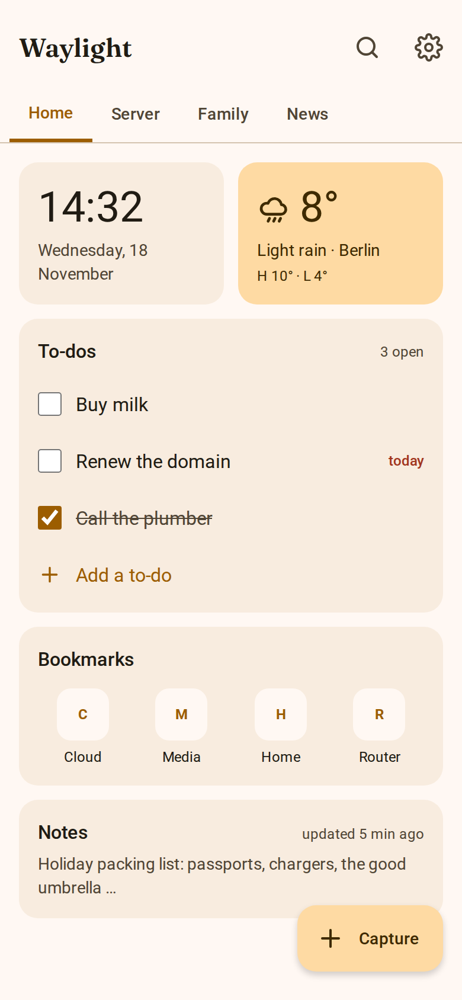 | 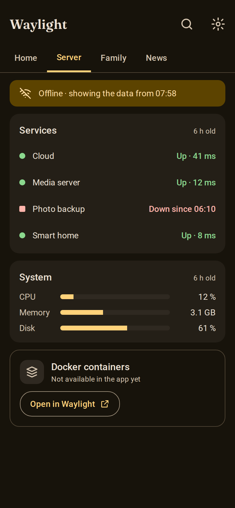 | 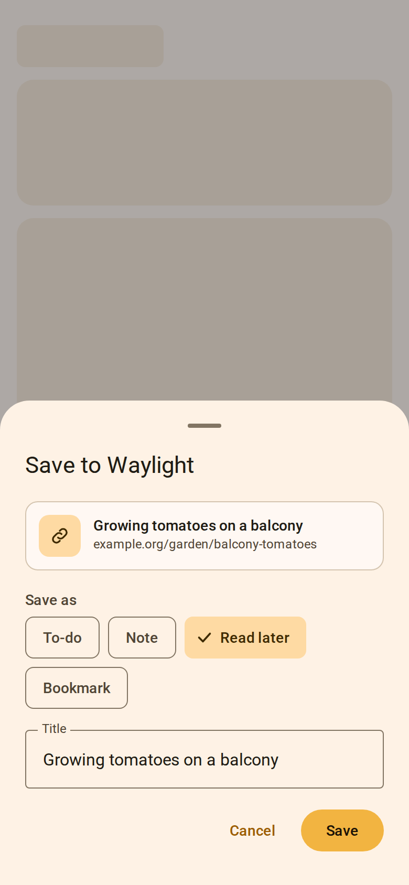 |
| **Dashboard**, Home tab with native widgets and the *Capture* button ([#16](https://github.com/Waylight-App/waylight-mobile/issues/16), [#17](https://github.com/Waylight-App/waylight-mobile/issues/17), [#19](https://github.com/Waylight-App/waylight-mobile/issues/19)) | **Server tab**, dark, offline banner, data age, fallback widget ([#18](https://github.com/Waylight-App/waylight-mobile/issues/18), [#23](https://github.com/Waylight-App/waylight-mobile/issues/23)) | **Quick capture** from the share sheet ([#20](https://github.com/Waylight-App/waylight-mobile/issues/20), [#21](https://github.com/Waylight-App/waylight-mobile/issues/21)) |
| 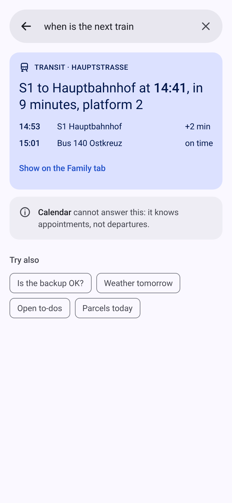 | 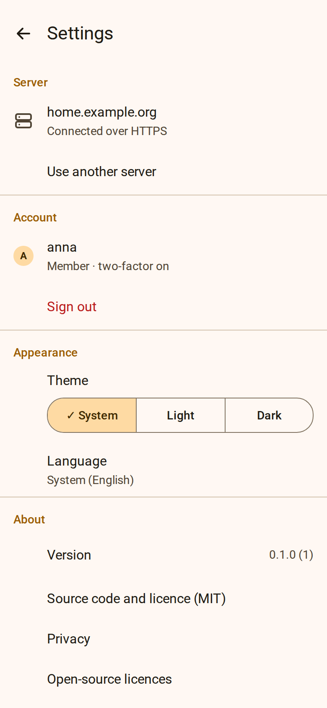 | |
| **Smart search**, with "why a source cannot answer" ([#22](https://github.com/Waylight-App/waylight-mobile/issues/22)) | **Settings** ([#14](https://github.com/Waylight-App/waylight-mobile/issues/14)) | |

### A home screen you arrange yourself ([#207](https://github.com/Waylight-App/waylight-mobile/issues/207))

| | |
| --- | --- |
| 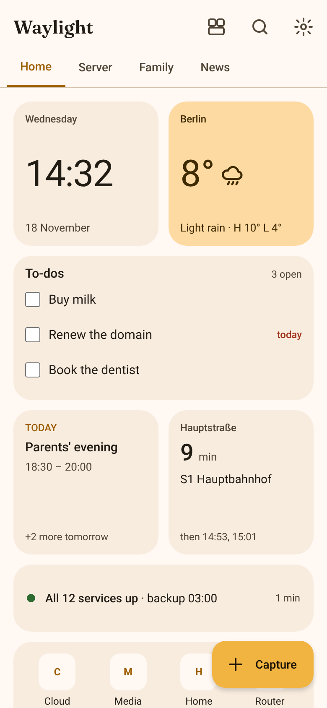 | 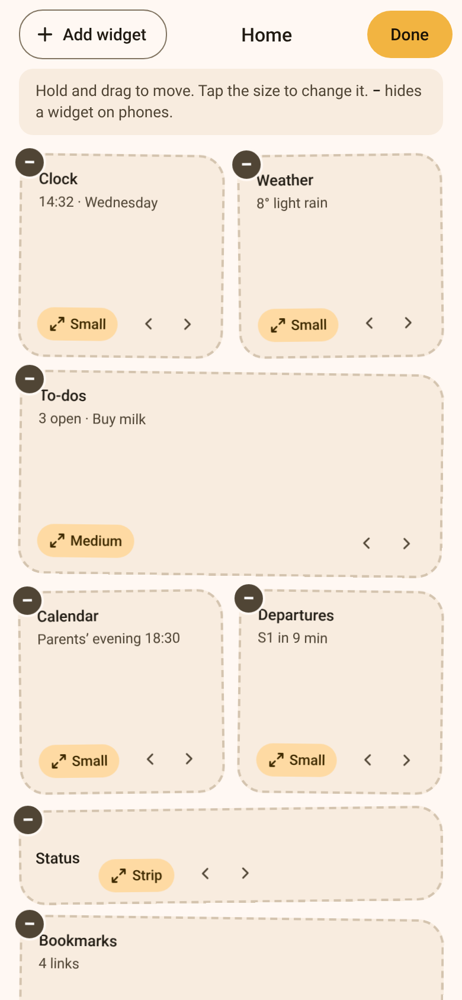 |
| **Grid of sizes**: small 2 × 2, medium 4 × 2, large 4 × 4, strip 4 × 1 on a grid 4 cells wide; tap opens a widget in full ([#208](https://github.com/Waylight-App/waylight-mobile/issues/208), ADR 0011) | **Edit mode**: hold to move, tap the size to change it, − hides on phones ([#209](https://github.com/Waylight-App/waylight-mobile/issues/209)) |
| 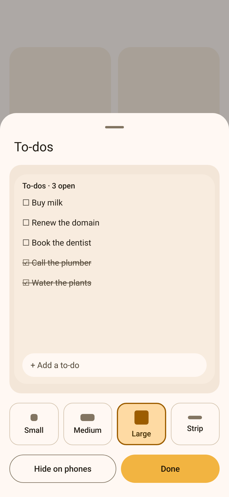 | 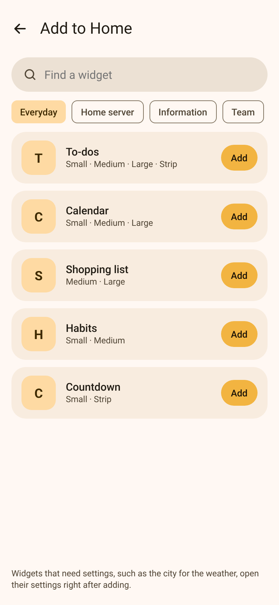 |
| **Choose a size** with a live preview ([#209](https://github.com/Waylight-App/waylight-mobile/issues/209), compact views [#211](https://github.com/Waylight-App/waylight-mobile/issues/211)) | **Add a widget** from the phone ([#210](https://github.com/Waylight-App/waylight-mobile/issues/210)) |

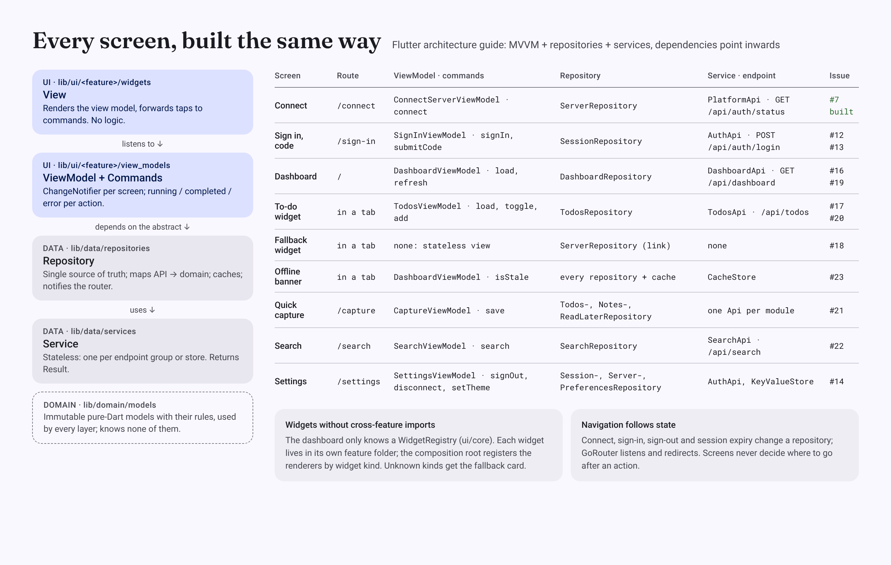

The last board maps every screen to its route, view model, repository and
service ([architecture](../architecture.md)).

## Design decisions

- **Material 3**, the design language of Android and of
  `package:material_ui`; on iOS the same look, with platform behaviour
  (back swipe, scroll physics) from Flutter.
- **Amber `#F2B441` as accent colour**, the default theme of the web
  interface. In code: `ColorScheme.fromSeed` with
  `DynamicSchemeVariant.fidelity`; filled buttons are Amber with dark text,
  and text and icons use the darker accent text of the web theme.
- **Light and dark** from the same seed; every screen works in both.
- **Type:** Roboto (the system font on Android, San Francisco on iOS) for
  everything; the wordmark *Waylight* in Fraunces, as on the sign-in card of
  the web interface (bundled with [#10](https://github.com/Waylight-App/waylight-mobile/issues/10), never loaded from the network).
- **Shapes:** stadium buttons 48 dp high, outlined text fields, filled
  cards with 16 dp corners, 16 dp page padding, 12 dp between cards.
- **States are explicit:** errors and the offline state are banners with an
  icon and text, never colour alone; every widget shows how old its data is
  once it is stale.
- **Accessible as drawn:** tap targets ≥ 48 dp, text contrast ≥ 4.5:1 in
  both themes, labels on every field and icon button.
