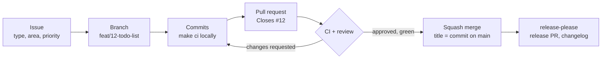

# Workflow

We work with [GitHub Flow](https://docs.github.com/en/get-started/using-github/github-flow):
`main` is always releasable, every change is a short-lived branch and a pull
request, and nothing reaches `main` without green CI and a review. The
server repository works the same way.



## 1. Issues

Every change starts with an issue, created with one of the issue forms.

- **Issue type** says what kind of work it is: *Feature* (new or changed
  behaviour), *Bug* (something is broken), *Task* (technical work without a
  visible change). Labels do not repeat the type.
- **Labels** say where and how urgent: one or more `area: …`, one
  `priority: …`, and if needed `needs: server` (waits for a change in the
  server repository), `needs: decision` (an ADR first), `blocked`,
  `good first issue`. The list is in [`.github/labels.yml`](../.github/labels.yml).
- **Epics** are parent issues labelled `epic`, one per roadmap phase. Their
  sub-issues are the actual work, so the progress bar of the epic shows how
  far a phase is ([ROADMAP.md](../ROADMAP.md)).
- **Acceptance criteria** are a checklist in the issue. An issue is done
  when all are checked, the pull request is merged and the docs are updated.
- An issue that needs the server links the server issue. The app issue
  stays `needs: server` until the server change is released.

## 2. Branches

Branch from an up-to-date `main`, named
`<type>/<issue>-<short-description>`:

```
feat/12-todo-list
fix/31-crash-on-empty-tab
docs/8-architecture
```

Keep branches short-lived (days, not weeks) and pull requests small: one
issue, ideally under 400 changed lines without generated files. Split
bigger issues into sub-issues.

## 3. Commits

Commits follow [Conventional Commits](https://www.conventionalcommits.org/):

```
<type>(<optional scope>): <subject in lower case, no full stop>
```

| Type | For | In the changelog |
| --- | --- | --- |
| `feat` | New or changed behaviour for users | Features |
| `fix` | A bug fix | Bug fixes |
| `perf` | Faster or leaner without new behaviour | Performance |
| `docs` | Documentation only | Documentation |
| `refactor` | Code change without behaviour change | – |
| `test` | Tests only | – |
| `build` | Dependencies, Gradle, Xcode, pubspec | – |
| `ci` | Workflows, Makefile, tooling | – |
| `chore` | Anything else | – |
| `revert` | Reverts an earlier commit | Reverts |

Scopes are the areas: `auth`, `dashboard`, `widgets`, `offline`,
`notifications`, `ux`, `a11y`, `i18n`, `android`, `ios`, `release`.
A breaking change gets a `!` (`feat(auth)!: …`) and a `BREAKING CHANGE:`
footer.

Commits on a branch can be messy; the pull request title is what lands on
`main`.

## 4. Pull requests

1. Run `make ci` locally.
2. Push and open a pull request. The template asks for the linked issue
   (`Closes #12`), the changes, screenshots for UI changes and a checklist.
3. The title is a Conventional Commit; it becomes the squash commit on
   `main` and with it the changelog entry.
4. Open it as a *draft* while you are still working; mark it ready when CI is
   green and you would merge it yourself.

### Checks

| Check | Workflow | Fails when |
| --- | --- | --- |
| Lint & test | `ci.yml` | `make ci` fails: generated files, format, analysis, tests, coverage |
| Build Android | `ci.yml` | The debug APK does not build |
| Conventional title | `pull-request.yml` | The title is not a Conventional Commit |
| Linked issue | `pull-request.yml` | The description closes no issue |
| Dependency review | `pull-request.yml` | A new dependency has a known vulnerability (moderate or worse) |

The labeler adds `area: …` labels from the changed files.

### Review

- Every pull request needs one approval from a code owner
  ([`.github/CODEOWNERS`](../.github/CODEOWNERS)).
- Reviewers check what tools cannot: names, architecture beyond imports,
  tests that test something, texts, accessibility, security.
- Comments are suggestions unless marked as blocking. The author resolves
  conversations; all must be resolved before merging.

### Merging

Squash merge only, with the pull request title as commit message. The
branch is deleted automatically. Use *auto-merge* to merge as soon as the
checks are green.

## 5. Dependencies

Dependabot opens grouped pull requests every Monday for pub packages and
GitHub Actions, and monthly for Gradle. A green Dependabot pull request
for minor and patch updates can be merged after a glance at the changelog;
major updates get a normal review. Actions are pinned to commit SHAs with
the version as comment, as in the server repository.

## 6. Releases

[release-please](https://github.com/googleapis/release-please) maintains a
release pull request from the commits on `main`. Merging it releases;
details in [releasing](releasing.md).

## Repository settings

These settings belong to the workflow; they are set by an admin in the
repository settings, because they cannot live in files.

**Branch ruleset for `main`** (Settings → Rules → Rulesets → New branch ruleset):

- Target: default branch; enforcement: active; bypass: none
- Restrict deletions, block force pushes, require linear history
- Require a pull request before merging: 1 approval, require review from
  code owners, dismiss stale approvals on new pushes, require conversation
  resolution; allowed merge method: squash
- Require status checks to pass, branches up to date: *Lint & test*,
  *Build Android*, *Conventional title*, *Linked issue*, *Dependency review*

**General** (Settings → General):

- Pull requests: allow squash merging only, default commit message *Pull
  request title*; allow auto-merge; automatically delete head branches;
  always suggest updating pull request branches
- Features: Issues on, Discussions optional (questions and ideas)

**Security** (Settings → Advanced Security):

- Private vulnerability reporting, Dependabot alerts and security updates,
  secret scanning with push protection: all on

**Actions** (Settings → Actions → General):

- Workflow permissions: read repository contents by default; allow GitHub
  Actions to create and approve pull requests (needed by release-please)

After the first merge to `main`, run the *Labels* workflow once
(Actions → Labels → Run workflow) to create the labels with their colours.
